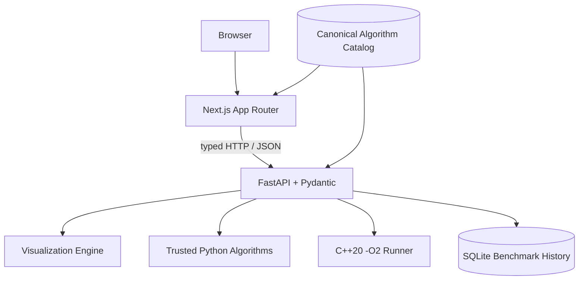
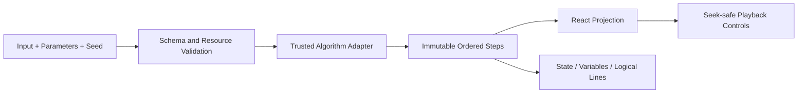
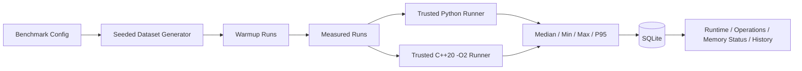

# CP-Lab Architecture

## Repository map

```text
apps/web/               Next.js App Router product UI and browser tests
apps/api/               FastAPI routes, schemas, services, and API tests
algorithms/python/      trusted Python reference implementations
algorithms/cpp/         trusted C++20 library, tests, and benchmark runner
packages/catalog/       canonical algorithm metadata and explanations
scripts/                cross-language checks and real-product asset capture
screenshots/            product-derived screenshots and GIFs
assets/                 GitHub social preview
```

## Overall architecture



Catalog browsing and statically generated detail content come from `packages/catalog/algorithms.json`. That file defines the canonical 20-entry V1 surface. Both applications consume it, and tests verify its count, unique slugs, code availability, endpoint behavior, and visualization coverage.

Operations requiring execution cross the typed HTTP boundary into FastAPI. The browser may submit bounded inputs, parameters, dataset settings, and seeds. It cannot submit Python, C++, shell commands, or any other arbitrary source code for execution.

## Visualization flow



`POST /visualize` validates the slug and request envelope, applies numeric, collection, graph, and request-size bounds, normalizes the input, and executes one repository-owned adapter. The response contains immutable ordered steps with descriptions, variables, highlighted logical lines, and optional array, graph, or tree state.

React renders the selected step. First, previous, play, pause, next, last, restart, speed changes, and timeline seeking only change the projection index; they never rerun the algorithm. Equal algorithm, input, parameters, and seed values produce an equal step sequence. Route/algorithm changes reset playback state before rendering the new sequence.

## Benchmark flow



`POST /benchmark` accepts one to four allow-listed algorithm identifiers plus a bounded dataset configuration. The service generates data from the supplied seed, excludes warmups, retains every measured sample, and uses a monotonic clock. Python calls trusted repository functions in-process. C++ invokes a cached runner built with C++20 and `-O2`; measurement happens inside that process, so compiler process startup is excluded.

The same language, generator configuration, input size, seed, warmup count, and measured-run count are used for every algorithm in a comparison request. The API computes median, min, max, and nearest-rank P95, attaches environment metadata, and persists the complete run to SQLite. Memory is `null` with an explicit explanation when trustworthy portable measurement is unavailable.

## Data and trust boundaries

| Boundary | Accepted | Rejected / unavailable |
| --- | --- | --- |
| Catalog | Source-controlled metadata and explanations | Runtime mutation from the browser |
| Visualization | Bounded JSON inputs, parameters, seed | Arbitrary code, oversized/nested data, invalid graph endpoints |
| Benchmark | Allow-listed slugs, enum generator, bounded sizes/runs/seed | Uploaded source, shell input, unknown algorithm adapters |
| Persistence | Parameterized SQLite inserts and reads | Client-provided SQL |
| Errors | Stable error code, message, request ID | Production stack traces |

Request bodies above 1 MB are rejected. Expensive benchmark execution is serialized by a process lock. CORS is an explicit origin list. Pydantic models reject unknown fields and silently coerced malformed values.

## Frontend/backend responsibilities

The Next.js application owns navigation, responsive layout, local playback state, visual projections, charts, and accessible interaction. FastAPI owns validation, trusted execution, deterministic step generation, statistics, environment metadata, persistence, and structured errors. This division prevents a browser animation or locally fabricated number from being presented as a backend algorithm result.

## Adding an algorithm

1. Add complete metadata and explanations to `packages/catalog/algorithms.json` with a stable lowercase slug.
2. Add the C++20 implementation to `algorithms/cpp/include/cp_algorithms.hpp`.
3. Add the Python implementation to `algorithms/python/cp_algorithms.py`.
4. Add normal, minimum, edge, large, randomized, invariant, and reference-model tests where applicable.
5. Add a deterministic adapter to `apps/api/core/visualization.py`.
6. If benchmarking is meaningful, add bounded trusted Python and C++ adapters.
7. Add examples, edge cases, related slugs, and capability flags to the catalog.
8. Verify detail, playground, benchmark, compare, mobile, and error states.
9. Run the complete release gate documented in `README.md`.
