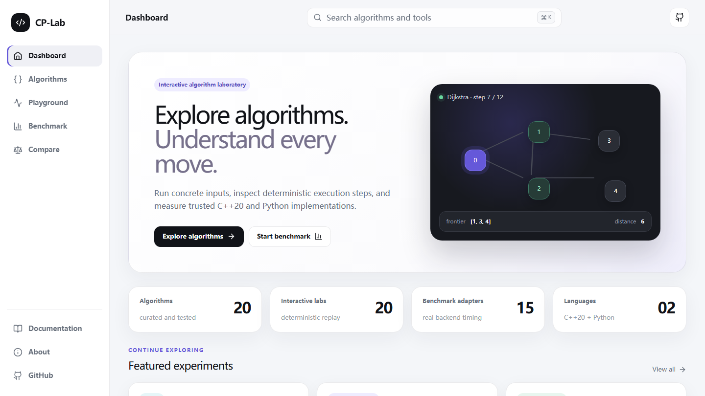
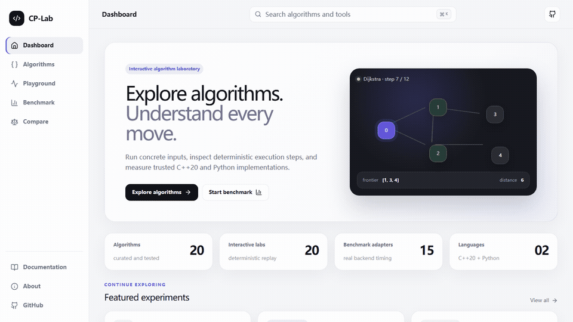
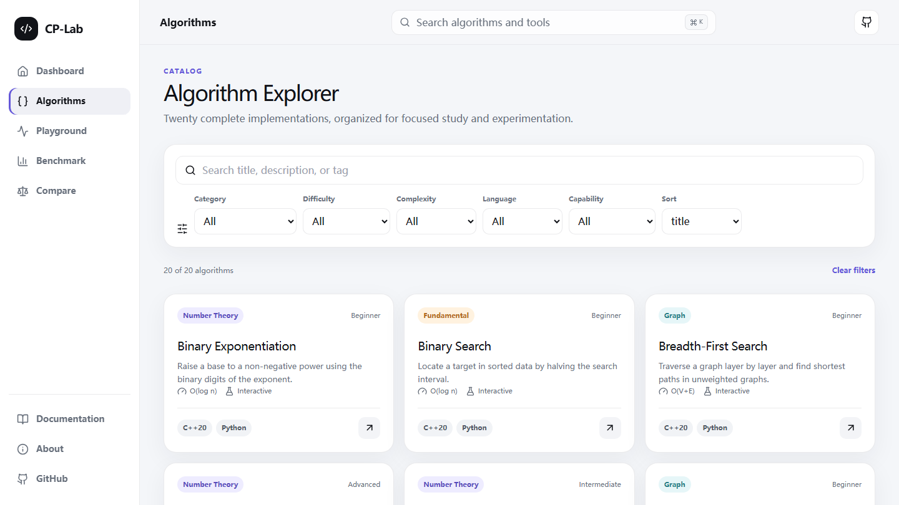
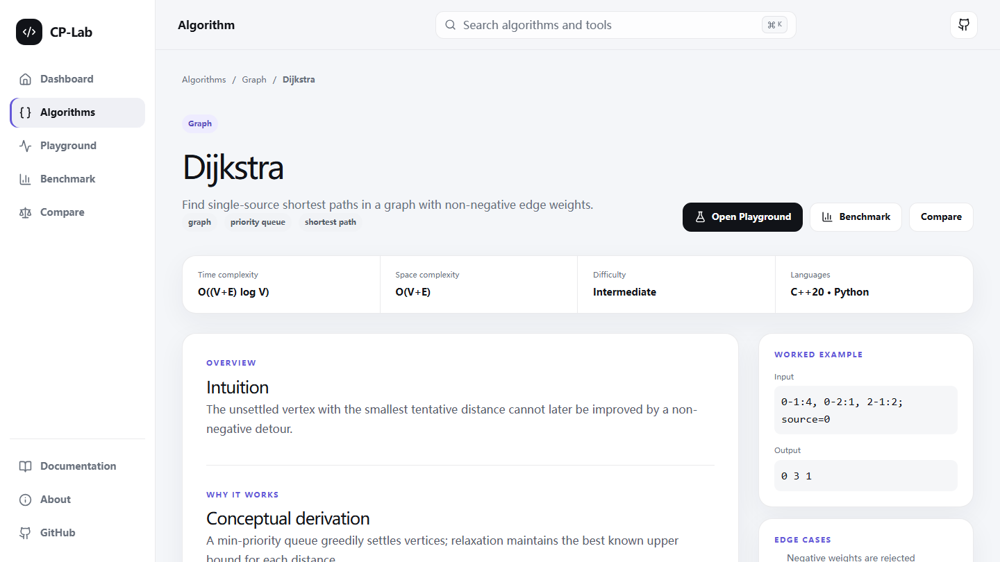
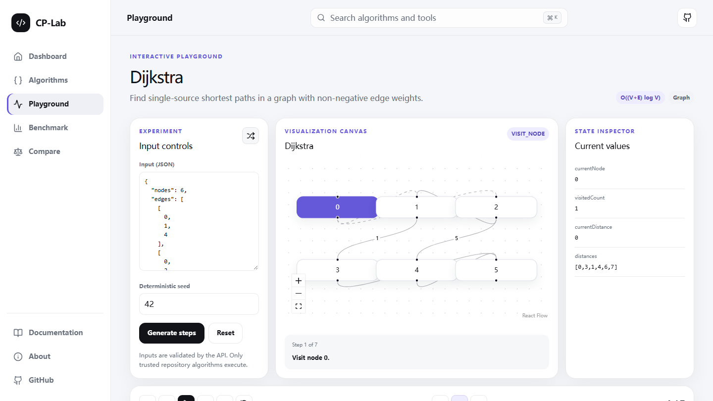
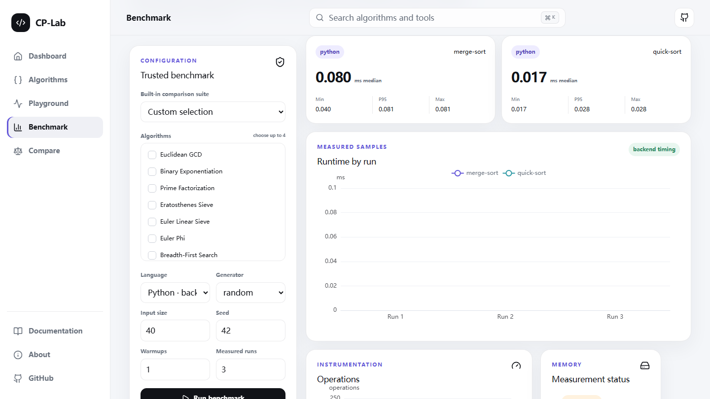
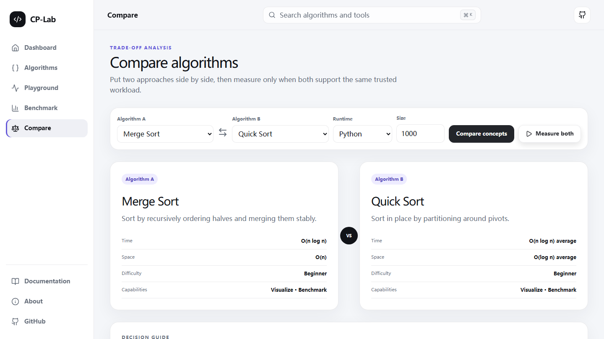
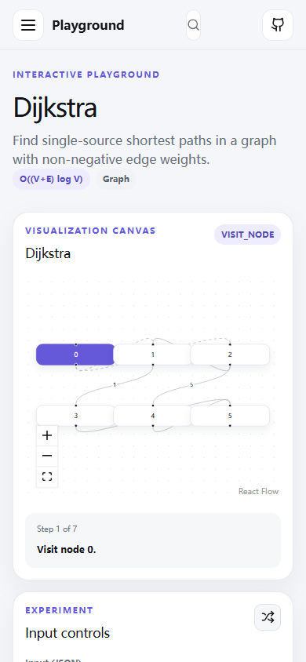

# CP-Lab

**A production-style competitive-programming laboratory for understanding how algorithms behave—and measuring how they perform.**

> Visualize · Experiment · Benchmark · Compare

   

[Documentation](./ARCHITECTURE.md) · [Getting started](#getting-started) · [Contributing](./CONTRIBUTING.md) · [Security](./SECURITY.md)



CP-Lab connects concise explanations, trusted C++20 and Python implementations, deterministic execution steps, editable inputs, reproducible backend benchmarks, and side-by-side trade-off analysis in one cohesive workspace. V1 deliberately ships 20 complete algorithms rather than a broad but shallow catalog.

> A public live-demo URL is not configured. The repository is deployment-ready; publishing requires deployment credentials and a public web/API origin.

## Product tour



| Algorithm Explorer | Algorithm Detail |
| --- | --- |
|  |  |

| Dijkstra Playground | Benchmark Lab |
| --- | --- |
|  |  |

| Algorithm Compare | Mobile workbench |
| --- | --- |
|  |  |

## What is included

- 20 curated algorithms across number theory, graphs, data structures, and fundamentals.
- C++20 and Python reference implementations with edge, randomized, invariant, property, and reference-model tests.
- Immutable visualization steps with number, array, graph, and data-structure projections.
- First/previous/play/pause/next/last/restart controls, three speeds, timeline seeking, state inspection, and logical line highlighting.
- Deterministic dataset generation and eight built-in comparison suites.
- Real Python and optimized C++20 backend benchmarks with raw samples, median, min, max, nearest-rank P95, operations where instrumented, explicit memory availability, environment metadata, and SQLite history.
- Searchable/filterable Explorer, algorithm detail pages, Compare, command palette, responsive workbench, designed loading/empty/error/404 states, and mobile navigation.
- FastAPI validation, bounded trusted execution, structured errors, Docker definitions, GitHub Actions, and frontend/API/algorithm/E2E quality gates.

## Benchmark integrity

The default methodology uses seed `42`, three warmups, and ten measured runs. Warmups never enter the summary. Every result retains raw millisecond samples and records the language, runtime/compiler, operating system, build mode, timestamp, seed, and run counts.

- Python and C++ measurements execute trusted repository implementations on the backend.
- C++ is compiled as C++20 with `-O2`; timing is captured inside the runner, excluding process startup.
- Browser JavaScript timing is never labeled as C++ timing.
- Memory remains explicitly unavailable when a portable per-operation measurement cannot be defended.
- Compare sends both algorithms through the same dataset configuration and seed.
- Arbitrary source-code execution is intentionally unsupported.

## Architecture

```text
Browser → Next.js / React / TypeScript → typed HTTP → FastAPI / Pydantic
                                                      ├─ visualization adapters
                                                      ├─ trusted Python algorithms
                                                      ├─ C++20 -O2 runner
                                                      └─ SQLite benchmark history
```

See [ARCHITECTURE.md](./ARCHITECTURE.md) for system, visualization, and benchmark flow diagrams plus the data-boundary contract.

## Algorithm coverage

| Family | Algorithms |
| --- | --- |
| Number theory | Euclidean GCD, Extended GCD, Binary Exponentiation, Modular Inverse, Prime Factorization, Eratosthenes Sieve, Euler Linear Sieve, Euler Phi, Combination C(n,k), Chinese Remainder Theorem |
| Graphs | BFS, DFS, Dijkstra, Topological Sort |
| Data structures | Disjoint Set Union, Fenwick Tree, Segment Tree |
| Fundamentals | Binary Search, Merge Sort, Quick Sort |

## Getting started

Requirements: Node.js 20+, Python 3.11+, and a C++20 compiler (`g++` by default).

```bash
npm install
python -m pip install -r apps/api/requirements.txt
```

Run the API and web app in separate terminals:

```bash
npm run dev:api
npm run dev:web
```

Open `http://localhost:3000`. OpenAPI is available at `http://localhost:8000/api/docs`.

On Windows, the provided `npm run dev:api` interpreter resolver selects a compatible Python installation even when another shell-specific `python` executable appears first on `PATH`.

## Docker

```bash
docker compose up --build
```

The web app is exposed on port `3000`, the API on `8000`, and SQLite data is persisted in the `cp_lab_data` volume. Configure production origins through `.env.example`; never use a wildcard CORS origin for deployment.

## Quality gates

Run the complete sequential gate first, then browser and release checks:

```bash
npm run check
npm run test:e2e
npm audit --omit=dev --audit-level=high --registry=https://registry.npmjs.org
docker compose config --quiet
```

`npm run check` includes ESLint, Next.js route type generation, TypeScript, Vitest, FastAPI tests, Python algorithm tests, C++20 compilation/reference checks, and the Next.js production build. Playwright additionally monitors `console.error` and uncaught `pageerror` events.

## Deployment

Deploy the two supplied Dockerfiles together or as separate services. Set:

- `NEXT_PUBLIC_API_URL` to the public API origin at web build time.
- `CP_LAB_CORS_ORIGINS` to the exact comma-separated web origins.
- `CP_LAB_DATABASE_URL` to a persistent SQLite path such as `sqlite:////data/cp_lab.db`.
- `CP_LAB_CPP_COMPILER` when the compiler is not `g++`.

No application secrets are required. A public URL is intentionally omitted until a real deployment exists.

## Project documentation

- [Architecture](./ARCHITECTURE.md)
- [Contributing](./CONTRIBUTING.md)
- [Security policy](./SECURITY.md)
- [Roadmap](./ROADMAP.md)
- [Changelog](./CHANGELOG.md)
- [Public release report](./PUBLIC_RELEASE_REPORT.md)

## License

MIT — see [LICENSE](./LICENSE).
